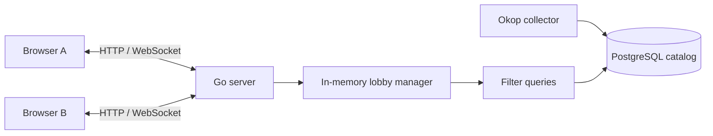

# Plown

A real-time web application for choosing a Steam game with friends. Instead of browsing the entire catalog independently, players join a shared lobby and take turns narrowing down the same list of games until the group finds something to play.

The catalog is collected by [Okop](https://github.com/smakimka/okop) and stored in PostgreSQL.

## Features

- Create or join a lobby using a short lobby code.
- Synchronize players, turn order, filters, and candidate counts over WebSocket.
- Include or exclude Steam tags and review categories.
- Filter free or paid games and exclude individual titles.
- Recalculate matching game counts and available filter statistics after each turn.
- Display candidate games once the remaining catalog is small enough, with links to their Steam store pages.

## Architecture



The backend is the source of truth for lobby state. Each lobby maintains its own players, filters, and active turn. The server applies filter changes, recalculates statistics with concurrent PostgreSQL queries, and broadcasts a state snapshot to connected players.

To keep large result sets out of WebSocket messages, the server sends individual game records only when the remaining candidate count is at most 150. Dynamic SQL is built using Squirrel, while PostgreSQL handles catalog filtering and aggregation.

### Tech stack

- **Backend:** Go 1.26.1, chi, Gorilla WebSocket, pgx, Squirrel
- **Frontend:** Svelte 5, SvelteKit, TypeScript, Vite
- **Storage:** PostgreSQL
- **Deployment:** Docker, Docker Compose, Caddy

## Getting started

### Prerequisites

- Go 1.26.1 or newer
- Node.js and npm compatible with the frontend dependencies
- A running PostgreSQL database populated using Okop

Plown does not create or migrate the database itself. Follow the [Okop setup instructions](https://github.com/smakimka/okop) to initialize the schema, import game metadata, and resolve tag names.

### 1. Build the frontend

From the repository root:

```sh
cd web
npm ci
npm run build
cd ..
```

SvelteKit generates a static single-page application in `web/build`, served by the Go backend.

### 2. Configure the backend

Set the environment variables for the PostgreSQL database used by Okop.

| Variable | Default | Description |
| --- | --- | --- |
| `SERVER_ADDR` | `:8080` | HTTP server listen address |
| `STATIC_DIR` | `web/build` | Built frontend directory |
| `PG_ADDR` | `localhost:5432` | PostgreSQL host and port |
| `PG_DB` | `parser_db` | Database name |
| `PG_USER` | `parser` | Database user |
| `PG_PASS` | Local development default in the source | Database password |

Note that Okop uses `games_db` by default, whereas Plown's native server defaults to `parser_db`. Set `PG_DB` explicitly to the database containing the catalog.

For example, in a POSIX shell:

```sh
export PG_ADDR=localhost:5432
export PG_DB=games_db
export PG_USER=parser
export PG_PASS='<your-local-database-password>'
go run ./cmd/server
```

The current PostgreSQL connection configuration disables TLS; use a trusted local network for development.

Open **http://localhost:8080** to create or join a lobby. To test synchronization locally, open a second browser tab, enter the same lobby code, and join with a different player name.

### 3. Frontend development (optional)

With the Go server running on port 8080:

```sh
cd web
npm run dev
```

The Vite configuration includes a development proxy for backend API and WebSocket requests.

## API overview

| Method | Path | Purpose |
| --- | --- | --- |
| POST | `/api/lobby` | Create a lobby and return its code |
| GET | `/api/lobby/{lobby_id}/ws` | Upgrade to a lobby WebSocket connection |
| GET | `/api/tags` | Retrieve the catalog's tags |
| GET | `/api/labels` | Retrieve review score labels |

WebSocket messages use a JSON envelope containing `type` and `msg`. The first client message must be a `join` message.

```json
{
  "type": "join",
  "msg": {
    "name": "Player",
    "lobby_id": "abc123"
  }
}
```

Client messages include `tag`, `remove_tag`, `game`, `free`, `review_label`, and `remove_review_label`. Server messages include `joined`, `state`, and `error`.

## Docker deployment

The supplied Dockerfile builds the Go server and copies the existing `web/build` output into the image. Build the frontend first.

The Compose configuration assumes an external Docker network named `shared-db` with a reachable database service named `db`, valid database credentials, and a local `Caddyfile` for the reverse proxy. It does not provision the database or include that Caddy configuration. Supply these separately before using Compose.

## Project layout

```text
cmd/server/          Server entry point
internal/handler/    HTTP and WebSocket handlers
internal/lobby/      Lobby state, turns, and filters
internal/protocol/   Client and server message types
internal/repo/       PostgreSQL queries
internal/entity/     Catalog data models
pkg/postgres/        Connection pooling and query tracing
web/                 SvelteKit frontend
```

## Project status

Personal project under development. Lobby state is stored in memory, so restarting the server clears existing rooms. The current implementation is intended for a single server instance and does not provide persistent lobby sessions or user accounts.

Plown is an independent project and is not affiliated with Valve or Steam.
